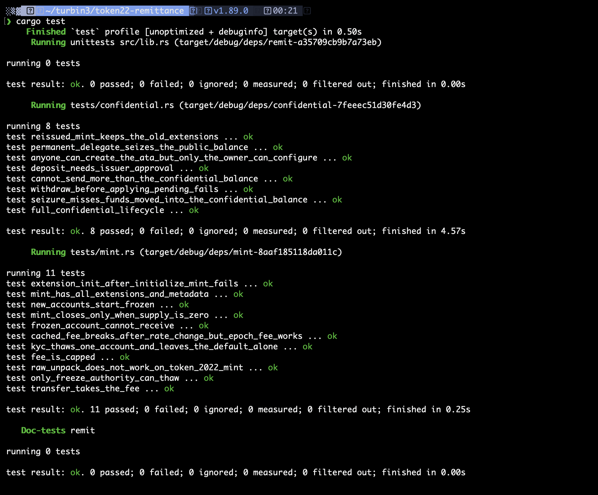

# token-2022 remittance stablecoin

Turbin3 Q4 builders assignment. A remittance stablecoin (`RUSD`) built only with Token-2022 extensions, no custom program. The crate builds the instructions and reads state, the tests run everything in LiteSVM.

Two versions of the mint:

- **v1**: transfer fee, metadata pointer (pointing at the mint itself), default account state frozen, mint close authority.
- **v2 (re-issue)**: same set, plus permanent delegate (seizure) and confidential transfers with manual approval. Confidential transfers can't be added to a mint after it exists, so this is a new mint.

## layout

```
src/
  mint.rs          task 1 + 5, builds the mint
  transfer.rs      task 2, transfer_checked_with_fee
  read.rs          task 3, all reads go through StateWithExtensions
  kyc.rs           task 4, thaw one account after KYC
  confidential.rs  task 6, configure / approve / deposit / apply / transfer / withdraw
tests/
  mint.rs          v1 tests
  confidential.rs  v2 tests
  common/mod.rs    LiteSVM setup
  fixtures/spl_token_2022_zk.so
```

## run

```
cargo test
```

19 tests, takes a few seconds (the zk proofs are the slow part).



## 1. the mint

`MintParams::extensions()` lists the extension types and `space()` sizes the account with `ExtensionType::try_calculate_account_len::<Mint>`. Order in `create_mint_ixs`:

1. create account (fixed-size extensions only)
2. initialize transfer fee config (0.5%, max 50.00)
3. initialize metadata pointer -> the mint's own address
4. initialize default account state = Frozen
5. initialize mint close authority
6. (v2) permanent delegate, confidential transfer mint, confidential transfer fee config
7. `InitializeMint2`
8. token metadata initialize

The metadata is the one thing after `InitializeMint2`. The metadata instruction needs an existing mint and the mint authority's signature, so it can't go first. It's variable length, so the account is created with the fixed size but funded with rent for the full size (`rent_bytes`), and the token program reallocs when the metadata is written.

Everything goes in one transaction. Extension inits don't need a signer, so if they were split up someone could initialize the mint in between.

## 2. transfers

`transfer::transfer_ix` builds `transfer_checked_with_fee`. The fee comes from `calculate_epoch_fee(current_epoch, amount)` on the mint's `TransferFeeConfig`, read fresh each time. Not a saved rate, because the fee authority can schedule a new fee that kicks in two epochs later. The test `cached_fee_breaks_after_rate_change_but_epoch_fee_works` shows a transfer with the old fee failing after the epoch moves, and the fresh one going through.

## 3. reading state

Token-2022 accounts are the normal layout plus TLV extension data. `Mint::unpack` on a mint with extensions just fails (there's a test for it). Every read in `read.rs` and `confidential.rs` uses `StateWithExtensions::<Mint>` / `StateWithExtensions::<Account>` and `get_extension`.

## 4. KYC

Every new account is frozen because of `DefaultAccountState`. `kyc::clear_kyc` thaws one account with the freeze authority. The mint's default stays `Frozen`, so the next account anyone opens is frozen again. Only the freeze authority can thaw.

## 5. re-issue

`V2Params` adds:

- `PermanentDelegate`: the seizure authority. It can transfer or burn from any account without the owner.
- `ConfidentialTransferMint` with `auto_approve_new_accounts = false` (approve_policy manual), so the issuer approves each account before it can use confidential balances.
- `ConfidentialTransferFeeConfig`. This one wasn't in the task list but you need it: a mint with a transfer fee and confidential transfers has to have it, otherwise there's nowhere to put the fee from a confidential transfer. The fee gets withheld encrypted under the issuer's ElGamal key.

## 6. confidential lifecycle

1. **create ATA**: anyone can do it and pay for it
2. **KYC**: the freeze authority thaws the account
3. **ConfigureAccount**: owner only. Reallocates the account for the confidential extensions and registers the owner's ElGamal key with a pubkey validity proof. A stranger trying this fails.
4. **ApproveAccount**: the issuer's confidential authority (manual policy)
5. **Deposit**: public balance -> pending
6. **ApplyPendingBalance**: pending -> available. You can't spend pending money, so this has to happen before a withdraw or transfer.
7. **Transfer**: on this mint it's `TransferWithFee`, which needs 5 proofs (equality, amount validity, fee, fee validity, range). They're too big for one transaction, so each one is verified into its own context state account, the transfer points at those accounts, and they get closed after so the rent comes back.
8. receiver applies pending
9. **Withdraw**: available -> public, with an equality proof and a range proof.

In `full_confidential_lifecycle` alice deposits 600.00, sends 200.00 to bob, bob receives 199.00 (0.5% fee withheld), applies it and withdraws 150.00.

## the gap: seizure vs confidentiality

The permanent delegate works on the public `amount` field. Confidential balances aren't in that field. They're ElGamal ciphertexts, and moving them needs proofs only the owner can make (it needs their secret key). So the two features don't overlap: the issuer can seize public tokens but not confidential ones.

## written finding: what if a sanctioned user moves into the confidential balance first?

Then the seizure doesn't work. `seizure_misses_funds_moved_into_the_confidential_balance` tests it: the user deposits everything, applies pending, and their public balance is 0. The permanent delegate's transfer fails even for 1 unit, there's nothing public to take.

What the issuer can still do:

- **freeze the account.** A frozen account can't deposit, apply, transfer or withdraw, so the money is stuck (the test checks the withdraw fails). But stuck isn't seized. The issuer can't move it or burn it either.
- **refuse approval.** With approve_policy manual the issuer can not approve accounts it doesn't like. That only helps before approval, a user who's already approved can deposit at any time.
- **auditor key.** If the mint has an auditor ElGamal key the issuer can decrypt transfer amounts. That's visibility, not control.

Side effect: frozen confidential funds stay in the supply forever unless the owner withdraws them, so the mint's supply never goes to 0 and the close authority can never close the mint.

So a permanent delegate is not a real seizure guarantee on a confidential mint. The issuer has to watch and freeze before the deposit happens. If the regulator needs actual recovery, Token-2022 has no way for the issuer to take a confidential balance, so it has to be stopped before it gets there.

## the token-2022 binary in tests/fixtures

LiteSVM comes with the mainnet build of Token-2022 v10, which is compiled without the `zk-ops` feature. Configuring an account works with it, but deposit, apply, transfer and withdraw all fail with `InvalidInstructionData`. I built Token-2022 `program@v10.0.0` from github.com/solana-program/token-2022 with its default features (`zk-ops` on) using `cargo build-sbf`, and the tests load that `.so` over the bundled one.

## tests

mint (v1)
- mint has all four extensions plus the metadata, pointer points at itself
- raw `Mint::unpack` fails, `StateWithExtensions` works
- initializing an extension after `InitializeMint` fails
- new accounts start frozen
- KYC thaws one account, the default and other accounts stay frozen
- only the freeze authority can thaw
- a frozen account can't receive
- transfer takes 0.5%, withheld on the receiver's account
- fee is capped at the max
- cached fee fails after a rate change, the epoch fee works
- mint can only be closed when supply is 0

confidential (v2)
- re-issued mint has the old extensions plus the new ones
- anyone can create the ATA, only the owner can configure it
- deposit fails until the issuer approves the account
- full lifecycle: deposit, apply, transfer with fee, apply, withdraw
- withdraw before applying pending fails
- can't send more than the confidential balance
- permanent delegate seizes a public balance
- seizure fails after the funds go confidential, freeze still blocks the withdraw
